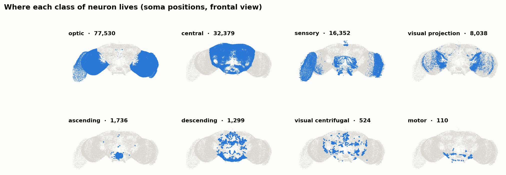
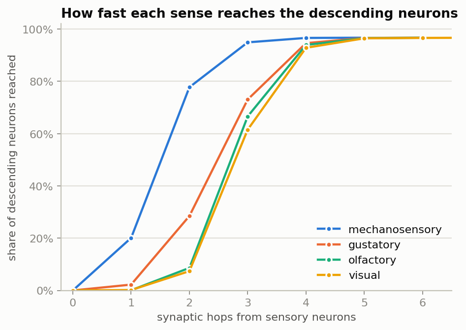
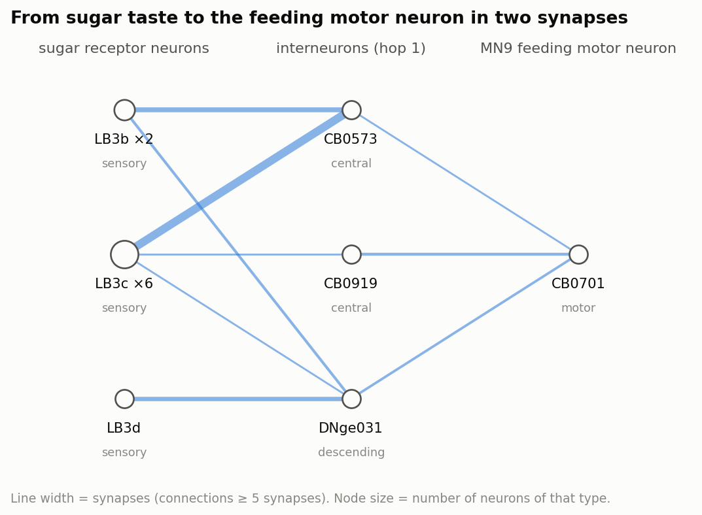
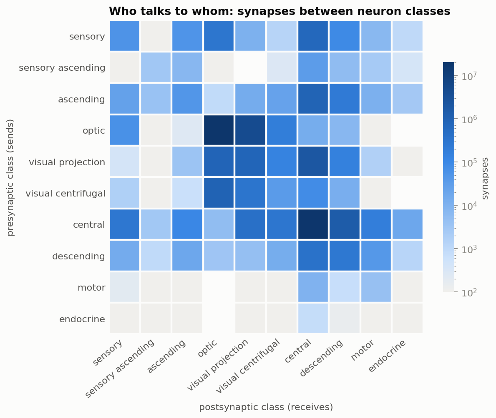
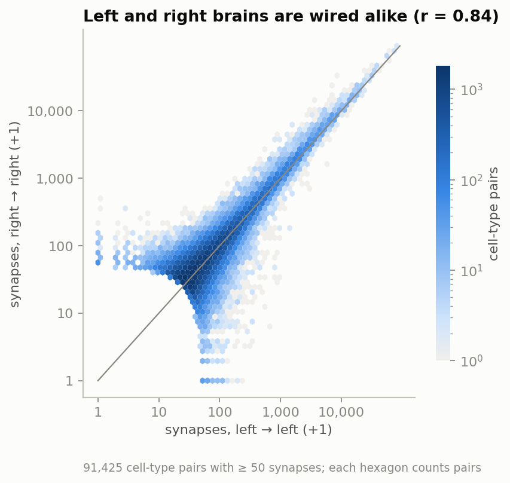

# FastFly: Fly Connectome Atlas

A graph analysis of the complete wiring diagram of an adult fruit-fly brain:
**138,639 neurons** and **54.5 million synapses** from the
[FlyWire](https://flywire.ai/) v783 connectome.

The project asks four questions of the network:

1. How is the brain organised: which classes of neuron talk to which?
2. How many synapses separate each sense from the neurons that drive behaviour?
3. What is the actual circuit from tasting sugar to starting to feed?
4. Which neurons are hubs, and how alike are the left and right halves of the brain?

Everything runs on a laptop CPU in under a minute. It needs no GPU and no simulation.



## Key findings

| | Finding |
|---|---|
| **Local wiring** | 37% of all synapses connect optic-lobe neurons to each other and 34% connect central-brain neurons to each other. |
| **Sense → action depth** | Touch reaches 78% of descending command neurons within 2 synapses. Taste reaches 28%, and smell and vision under 10%. Within 4 synapses every sense reaches more than 90%. |
| **Sugar → feeding** | Sugar-sensing taste neurons reach **MN9**, the motor neuron that extends the proboscis, in just **2 synapses**. The strongest route runs through descending neuron DNge031. |
| **Hubs** | The neurons with the highest synapse-weighted PageRank are **APL** and **DPM**, giant neurons spanning the mushroom body (the learning centre), and **CT1**, which spans the optic lobe. |
| **Reciprocity** | Pairs of neurons that connect in both directions are **~1,000×** more common than in a random network with the same density. |
| **Symmetry** | Cell-type-to-cell-type wiring correlates at **r = 0.84** between the left and right hemispheres, across 91,425 type pairs. |
| **Heavy tails** | The median neuron has ~70 input and ~80 output partners; a handful exceed 10,000. |

<p>


</p>
<p>


</p>

## Interactive dashboard

`dashboard/index.html` is a single self-contained page with every analysis in interactive form:
- a hoverable soma map that identifies each neuron
- the class-to-class wiring heatmap
- the sense-to-action curves, with a target toggle
- the sugar → MN9 circuit
- a sortable, searchable hub table
- the degree, symmetry and neurotransmitter charts

Open it in a browser, or publish it with GitHub Pages (Settings → Pages → deploy from the `main` branch, then visit `/dashboard/`).

## Fly Maze Runner: a connectome-driven fly

`navigate/` is an interactive simulation. You draw a 2D map with walls, a start and a goal, and a virtual fruit fly tries to reach the goal. **Its steering comes from a spiking simulation of the whole FlyWire brain**: 138,639 leaky integrate-and-fire neurons, with no trained weights.

```bash
python navigate/server.py      # loads the brain (~5 s), then open http://localhost:8000
python navigate/run.py navigate/maps/maze.json      # same simulation, no browser
```

How the loop works, every 20 ms of simulated time:

| Stage | What happens | Source |
|---|---|---|
| Eyes | A goal in the left visual field drives the left **LC10a** neurons (object tracking). A nearby wall drives that side's **LPLC2** neurons (looming). | model |
| Brain | Those rates are injected as Poisson spikes into the full connectome, using the Shiu et al. (2024) LIF model | connectome, untuned |
| Readout | Left-minus-right activity of the steering descending neurons **DNa01 + DNa02** | Rayshubskiy et al. 2020 |
| Body | Walks at a set speed, turns by the readout, adds random wandering, slides along walls | model |

What the connectome does without tuning: LC10a excites the **same-side** DNa02, so the fly turns toward the goal. LPLC2 excites the **opposite-side** DNa01/DNa02, so it turns away from walls. Smell was tested as well. Left and right smell receptors produce almost the same descending output, because each antenna feeds both sides of the brain, so smell can't steer in this model.

| Map | Reached? (seeds 0 / 1) | Simulated time |
|---|---|---|
| Open field | yes / yes | 4.9 s / 4.5 s |
| Wall in the way | yes / yes | 7.0 s / 5.4 s |
| Corridor turn | yes / yes | 6.4 s / 29.5 s |
| Small maze | yes / yes | 26.3 s / 38.3 s |

When the goal is in view, the brain's steering points toward it in 77–98% of time steps. The fly has no map or memory, so when the goal is hidden it wanders, using wall avoidance, until it sees the goal again.

**The brain engine** ([flyconn/brain.py](flyconn/brain.py)) is an event-driven, Numba-compiled port of the Shiu et al. model. It updates only neurons away from rest. On the sugar experiment it gives 16.8–17.3k spikes and 394–406 active neurons per simulated second, inside the range of the six simulators benchmarked in fly-brain (16.4–17.4k, 380–416). It runs at about 1.4 s of compute per simulated second when the brain is quiet. Near walls the looming input recruits ~45,000 neurons, which slows it to about 5–8 s.

## Reproduce

```bash
python -m venv .venv && source .venv/bin/activate
pip install -r requirements.txt

./scripts/download_data.sh        # ~130 MB: connectome + annotations
python run_analysis.py            # ~1 min, ~4 GB RAM -> outputs/figures, outputs/tables
python dashboard/build.py         # -> dashboard/index.html
pytest                            # unit tests on a small synthetic connectome
```

If another Python environment (for example ROS) injects pytest plugins, run
`PYTEST_DISABLE_PLUGIN_AUTOLOAD=1 pytest`.

## Methods

- **Graph.** Neurons are nodes. Edges are neuron pairs with at least one synapse, weighted by synapse count (15.1M edges). Hop counts and paths use only *strong* edges (≥ 5 synapses, 2.7M edges), the usual FlyWire threshold for filtering out false positives.
- **Sign.** Synapses from GABA- and glutamate-releasing neurons count as inhibitory, following Shiu et al. (2024).
- **Sensory depth.** A multi-source breadth-first search from all sensory neurons of one modality, run with `scipy.sparse.csgraph` from a virtual super-source.
- **Strongest shortest paths.** The search keeps only neurons that lie on *some* fewest-hop route (forward distance + backward distance = path length). A layered k-best search then ranks those routes by their weakest link (the bottleneck, in synapses).
- **PageRank.** Weighted by synapse count, with α = 0.85, computed by power iteration on the sparse matrix.
- **Symmetry.** For every pair of cell types present in both hemispheres, the search sums left→left synapses and right→right synapses separately. It keeps pairs with ≥ 50 synapses in total and reports the Pearson r of log(1 + count).

## Project layout

```
flyconn/data.py        load connectome + annotations into a Connectome object
flyconn/analysis.py    summary stats, PageRank, BFS depth, strongest paths, symmetry
flyconn/plots.py       static figures
flyconn/brain.py       whole-brain LIF simulation (Numba, event-driven)
flyconn/world.py       2D grid maps, ray casting, line of sight
flyconn/agent.py       eyes -> brain -> legs closed loop
navigate/              web app (server.py + index.html), run.py CLI, example maps
run_analysis.py        runs everything -> outputs/
dashboard/             template.html + build.py -> index.html
tests/                 unit tests on a hand-built 3–6 neuron graph
scripts/download_data.sh
```

## Data and credits

- Connectivity: FlyWire v783 (Dorkenwald et al., *Nature* 2024), as packaged by [eonsystemspbc/fly-brain](https://github.com/eonsystemspbc/fly-brain).
- Cell types, classes and predicted neurotransmitters: [FlyWire annotations](https://github.com/flyconnectome/flywire_annotations) (Schlegel et al., *Nature* 2024).
- Sugar receptor neurons and MN9 IDs: Shiu et al., *Nature* 2024.
